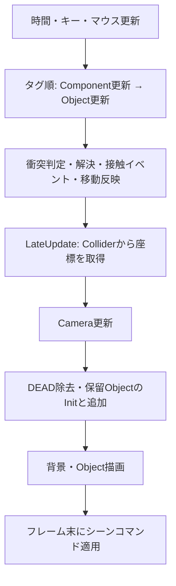

# Phase 0: 既存基盤の再利用調査（Issue #2）

調査日: 2026-10-17 JST。対象: main `86fce548461ac8c2b5c72e81cedecf6c1196bd1f`（PR #25マージ後）。担当: 開発担当AI（単独）。
本報告はソースの静的調査であり、新しいゲーム仕様の承認や動作保証ではない。初回成果は本書のみ。追加照合では[参照元の記録](UpstreamReference.md)、README、基盤のライセンス通知、取得依存物のGit除外設定を補足した。既存コード・ビルド設定・依存ライブラリ本体は変更しない。

2026-10-17追加照合: ユーザー提示の2DGameSample `develop-dxlib` / `00aa2c4482bfea9319163ea9c6e5c6b4e3a6ef58`と、調査基準mainのProjectName配下133ファイル・setup.batはGit blobが一致。既存の調査前提にコード差はない。基盤文書に記載された追加制約と環境差は[UpstreamReference](UpstreamReference.md)に整理した。

## 結論と適用範囲

既存のGameObject/Component、シーン、入力、描画、リソース、衝突、Cameraを土台に段階的に拡張できる。全面置換は不要と考える。一方、8方向入力をそのまま有効化すること、移動値を秒単位の速度としてColliderに渡すこと、単体Enemyを無検証で大量生成へ拡張することは避ける。以下の接続条件とリスクを先に確認する。

GameDesign §2の独立移動・拠点の継続前進は確定。8方向、一定速度、固定ステージ、カメラ方式は暫定または未確定であり、実装前の判断先は#3。戦闘は#8、勝敗・HUDは#13で判断する。本書の推奨は仕様承認ではない。

調査開始時のProjects: #1/#24、PR #23/#25がDone、#2/#3がReady。GitHubで#1のClosedとPR #25のMergedを確認。**#24はProjectsのDoneに対しIssue自体はOpenで、本文もレビュー待ちのまま**だった。これは管理上の不一致として記録し、本Issueの依存には追加しない。#2は依存なし、運用に明記された#1→#2の順で選定した。

## 1. 呼出順と移動値の契約

根拠: [Execution.cpp](../ProjectName/code/GameSystem/Execution/Execution.cpp)、[SceneManager.cpp](../ProjectName/code/Scene/SceneManager/SceneManager.cpp)、[Play.cpp](../ProjectName/code/Scene/Play/Play.cpp)、[ObjectManager.cpp](../ProjectName/code/Object/ObjectManager/ObjectManager.cpp)。

1. Execution: AppCtxをActivate → exe相対のresourcesをコピー → Window初期化 → Library → SceneManager生成。最初のTitleはコンストラクターで構築される（この経路ではInitを呼ばない）。
2. 各フレーム: ProcessMessage → FrameRate計算 → KeyStatus → MouseStatus → 現シーンUpdate → Clear/シーンDraw/ScreenFlip → ChangeScene。
3. Play::Update → ObjectManager::Update。`OBJECT_TAGS`の **NONE→MAP→PLAYER→ENEMY→GOAL** 順、同タグ内はvector順。各オブジェクトについてComponent群Update→ObjectのUpdateを実行する。全Componentを先に更新する方式ではない。
4. 全Object更新後にColliderManager::Step → 全ObjectのLateUpdate → Camera::Update → RefreshObjects（DEAD除去・保留追加）。DEADを立てても、このフレームの衝突・LateUpdateはスキップされない。
5. Playは更新後のクリアフラグからCmdReplaceを返す。そのフレームはPlayを描画し、フレーム末にResultへ置換・Initする。
6. Play描画は背景→タグ順にComponent描画→Object描画。Mapは画面内タイルを選別するが、ObjectManagerの更新には画面内判定がない。したがって画面外の独立更新を組み込める。ただし長距離・多数体での性能は未測定。

`m_velocity`という名前でも、Player→Colliderの経路では**1フレームの変位**。MoveWithKeyが速さ×deltaTimeを書き、Player::UpdateがSetVelocityへ渡し、RectCollider::AddVelocityはdeltaTimeを掛けず座標へ加算する。Player::LateUpdateで座標・残った変位を読み戻す。拠点移動もこの契約を使うならdeltaTimeを二重に掛けない。Colliderの外でもm_posを加算すると二重移動になる。

ComponentManagerは`unordered_map<type_index, shared_ptr<ComponentBase>>`を走査するため、**コンポーネント間の更新・描画順は登録順ではない**。同型を追加すると前の登録を置換する。今の横移動とJumpは主に別軸を書くが、垂直移動とJumpを同時に有効にするとYの上書き順に依存する。

## 2. 領域別の責務・寿命・再利用判定

「再利用可能」は既存機構を使えるという意味で、未測定のMVP条件まで合格した意味ではない。「小変更」は局所修正候補、「追加」はゲーム固有の不足、「不明」は仕様回答または測定が必要なもの。

| 領域・実ファイル | 責務・更新接点 | 所有と寿命 | 区分・使い方 |
|---|---|---|---|
| [GameObject.ixx](../ProjectName/code/Object/GameObject/GameObject.ixx) / [cpp](../ProjectName/code/Object/GameObject/GameObject.cpp)、[ObjectManager.ixx](../ProjectName/code/Object/ObjectManager/ObjectManager.ixx) / [cpp](../ProjectName/code/Object/ObjectManager/ObjectManager.cpp)、[ObjectTag.ixx](../ProjectName/code/Object/GameObject/ObjectTag.ixx) | 位置・変位・状態、タグ別更新、Init/Update/LateUpdate/Draw | SceneBaseがManagerをunique_ptr所有。objectsはshared_ptr、pendingObjectsは生ポインター。AddObjectでColliderManagerを渡しOnAttach、初期配置はInitBeforeUpdateで参照解決→Init | 再利用可能。拠点タグ等を追加する場合はenumだけでなくOBJECT_TAGSと文字列変換も更新。動的追加の注意はR4 |
| [ComponentManager.ixx](../ProjectName/code/Component/ComponentManager/ComponentManager.ixx) / [cpp](../ProjectName/code/Component/ComponentManager/ComponentManager.cpp)、[ComponentBase.ixx](../ProjectName/code/Component/ComponentBase/ComponentBase.ixx) | 型単位の追加・取得・削除、全登録を更新/描画 | GameObjectがManagerをshared_ptr所有。Componentのownerは非所有の生ポインター。外部shared_ptrで延命するとowner寿命とずれる | 再利用可能。順序依存の処理を増やさず、必要な順序は所有Object側で明示する局所対応を優先 |
| [ColliderManager.ixx](../ProjectName/code/Collision/ColliderManager/ColliderManager.ixx) / [cpp](../ProjectName/code/Collision/ColliderManager/ColliderManager.cpp)、[Collider.ixx](../ProjectName/code/Collision/Collider/Collider.ixx)、[ColliderFilter.ixx](../ProjectName/code/Collision/Collider/ColliderFilter.ixx) | シーン単位の矩形・円・タイル管理、フィルター、イベント、Step | Managerがunique_ptr所有、Objectは世代付きIDで参照。Destroyは世代検査・解放・再利用、最大世代は退役。ObjectManagerはColliderManagerをobjectsより先に宣言し、通常はObject破棄後にColliderManagerが破棄される | 再利用可能＋小変更候補。多体破棄、マスク、移動・trigger契約はR2/R3/R5/R6 |
| [RectColliderVisitor.cpp](../ProjectName/code/Collision/RectCollider/RectColliderVisitor.cpp)、[CircleColliderVisitor.cpp](../ProjectName/code/Collision/CircleColldier/CircleColliderVisitor.cpp)、[ColliderVisitor.ixx](../ProjectName/code/Collision/Collider/ColliderVisitor.ixx)、[TileColliderVisitor.cpp](../ProjectName/code/Collision/TileCollider/TileColliderVisitor.cpp) | 形状別dispatch、サブステップ、解決、両側へのイベント。TileはRectを軸別に動かし解決 | VisitorはColliderが所有し、自分のColliderを参照。イベントはCollider内に保存、Objectのthis等を捕捉 | 再利用可能だが全形状・高速移動の保証は不明。イベント内で直接Destroyせず状態を立て、走査後に破棄する |
| [Animator.cpp](../ProjectName/code/Component/Animator/Animator.cpp)、[Animation.cpp](../ProjectName/code/Asset/Animation/Animation.cpp)、[DivisionGraph.cpp](../ProjectName/code/Asset/DivisionGraph/DivisionGraph.cpp) | 分割画像・アニメ定義、Objectごとの再生状態、deltaTimeでフレーム更新。WorldToScreen後に描画 | Asset側が画像ハンドル/定義、Animator側が再生状態。Player破棄時に名前指定で画像と定義を削除 | 再利用可能。多数体の共有画像を各Objectが削除しない所有方針は追加時に必要 |
| [KeyStatus.cpp](../ProjectName/include/MyLib/KeyStatus/KeyStatus.cpp)、[MouseStatus.cpp](../ProjectName/include/MyLib/MouseStatus/MouseStatus.cpp)、[Button.cpp](../ProjectName/code/UI/Button/Button.cpp) | 毎フレーム押下開始/継続/解放を記録。Buttonは領域内の左クリック開始・解放で通知 | Key/Mouseは静的Instance。UIManagerはAppCtx内、TitleがボタンIDを持ち破棄時にDestroy | 再利用可能。ゲーム入力と画面座標UIを分離。8方向制御はR1の局所修正と#3判断後 |
| [AssetManager.ixx](../ProjectName/code/Asset/AssetManager/AssetManager.ixx)、[Graph.cpp](../ProjectName/code/Asset/Graph/Graph.cpp)、[Sound.cpp](../ProjectName/code/Asset/Sound/Sound.cpp)、[AudioSource.cpp](../ProjectName/code/Component/AudioSource/AudioSource.cpp) | 型別Asset取得、名前別画像/音ハンドル、再生。ロード完了の共有登録はPostToMain | AppCtxがAssetManager、Managerが型別Assetをunique_ptr所有。ハンドルの名前空間は全シーン共通。Graph等は明示削除/破棄でDxLib解放 | 再利用可能。音の多重再生・名前共有・失敗時の解放は実機未検証。Sound::DeleteHandleはmap項目を消さずDeleteSoundが消す |
| [FileSystem.ixx](../ProjectName/include/MyLib/FileSystem/FileSystem.ixx)、[Loading.cpp](../ProjectName/include/MyLib/Loading/Loading.cpp)、[LoadingContext.ixx](../ProjectName/include/MyLib/Loading/LoadingContext.ixx) | exe相対の仮想パス、JSON/CSV、レベル順の非同期読み込み | LoadingContextはthread_local生ポインター、LoadingSceneがSet/Release。Loading破棄はキャンセルを立てrunner終了を待つ。ワーカーから捕捉したLoadingにPostToMain | 再利用可能。Map生成はLoadingContext必須。動的生成中の読み込み・キャンセル境界はR8 |
| [SceneBase.ixx](../ProjectName/code/Scene/SceneBase/SceneBase.ixx)、[SceneManager.cpp](../ProjectName/code/Scene/SceneManager/SceneManager.cpp)、[LoadingScene.cpp](../ProjectName/code/Scene/LoadingScene/LoadingScene.cpp) / [ixx](../ProjectName/code/Scene/LoadingScene/LoadingScene.ixx) | stack最上位のみUpdate/Draw、Push/Replace/Pop/Quitを描画後に適用 | stackはshared_ptr。Replaceは次シーンを生成してから旧シーンをpop。LoadingSceneはholdScene/nextSceneを保持し読み込み中の寿命を延長 | 再利用可能。勝敗をSceneCmdへ変換するゲーム固有状態は追加。最後のPop後の空stack検査がなく、空にする使い方は要対処 |
| [FrameRate.cpp](../ProjectName/code/GameSystem/FrameRate/FrameRate.cpp) / [ixx](../ProjectName/code/GameSystem/FrameRate/FrameRate.ixx)、[Jump.cpp](../ProjectName/code/Component/Jump/Jump.cpp) | 高精度時刻差を秒に変換。ObjectはdeltaTimeへのconst参照を保持 | FrameRateは静的Instance、Sceneより長命。固定ステップやdeltaTime上限はこの実装にない | 再利用可能＋小変更候補。Jump重力は毎フレーム定数加算。FPS非依存の保証は不明（R7） |
| [Camera.cpp](../ProjectName/code/GameSystem/Camera/Camera.cpp) / [ixx](../ProjectName/code/GameSystem/Camera/Camera.ixx)、[Map.cpp](../ProjectName/code/Object/Map/Map.cpp) | 単一対象追従、画面1/3を基準、補間とワールド境界clamp、WorldToScreen。Mapがワールドサイズを設定 | Cameraは静的Instance、対象位置は非所有生ポインター。Player破棄時に一致する対象を解除。位置・サイズはシーンを越えて残る | 再利用可能＋小変更候補。複合追従/境界/再開始リセットは#3/#6。長距離精度・画面外性能は不明 |

### ロード・破棄時に維持すべき順序

TitleのStartはLoadingSceneへReplaceし、旧TitleをholdSceneとして保持する。LoadingSceneがContextを用意してPlayを生成し、Map/TileCollider/画像/音のタスクを登録する。LoadingはDATA→INIT→GRAPH→SOUND→FINALのレベル順、同レベルは並列。MapはpromiseでMapInfoを渡し、TileColliderが待つ。共有データの反映はLoadingScene::UpdateのPumpMainで行う。完了を見た後もPumpMainしてからPlayを返し、Replace後のPlay::InitでObject初期化を実施する。

通常のPlay破棄では各ObjectのデストラクターがColliderをDestroyする。CameraはPlayerが解除する。外部がGetObjForTagのshared_ptrを保持したままシーンを越えると、Objectの非所有ColliderManager参照が先に失効し得る。ターゲット参照はシーン内に限定し、必要ならweak_ptrを検討する。GameObjectのGetReferenceObjectを呼ぶのは初期配置経路だけで、後から追加したObjectのInitと同じ契約ではない。

Execution破棄はSceneManagerをresetしてからAppCtxをDeactivateし、Libraryメンバー破棄へ進む。シーンやObjectのデストラクターからAsset/UIへアクセスする現在の順序を維持する。Resultの画像はResultデストラクターでは削除せず、次回同名ロードまたはAsset破棄まで保持される。

## 3. 既存サンプルとMVPとの差

根拠: [Player.cpp](../ProjectName/code/Object/Character/Player/Player.cpp)、[MoveWithKey.cpp](../ProjectName/code/Component/Move/MoveWithKey/MoveWithKey.cpp)、[Jump.cpp](../ProjectName/code/Component/Jump/Jump.cpp)、[Enemy.cpp](../ProjectName/code/Object/Character/Enemy/Enemy.cpp)、[Goal.ixx](../ProjectName/code/Object/Goal/Goal.ixx)。

| 対象 | 現在の実装 | MVPへ向けた区分・判断先 |
|---|---|---|
| プレイヤー | JSON初期値、左右キーで横移動、SpaceでJump、接地イベントで再ジャンプ可能。水平変位に応じ歩行アニメ/音を切替 | 小変更候補。8方向は暫定。#3で画面構成/操作/斜め速度方針を決めてから#4で設定・入力修正。見下ろし採用ならJumpを接続しない案。基盤から削除しない |
| 拠点 | 該当Object・タグ・自動前進処理なし | 追加が必要。#5でGameObject派生の単純な拠点を候補にし、入力と独立して更新。1種類の移動だけなら汎用経路システムは不要 |
| 敵 | 静止した円。Playerとの接触で**敵自身**のHPが`damage * deltaTime`ずつ減り、次のUpdateでDEADになる | 追加が必要。追跡・標的選択・攻撃・スポーン機構なし。これはプレイヤー攻撃や拠点へのダメージの完成実装ではない。#8判断後、#9～#11 |
| ステージ | JSON/CSVの固定タイル、solid/one-way足場、画面内描画。全マップを読み込み・チャンク化 | 固定仮ステージなら小変更候補。横スクロール足場をそのまま見下ろしの地形仕様にしない。#3/#4。大規模生成は対象外 |
| 衝突 | 矩形/円/タイル、カテゴリマスク、コールバック、解決機構あり | 再利用可能。移動拠点・複数敵を入れる前に下記R2～R6の再現確認。新規物理エンジン導入の根拠はない |
| 勝敗・HUD | Goal接触でboolを立てResultへ。RでTitle、TitleのExitで終了 | 追加が必要。拠点HP、進行量、敗北、同時勝敗判定、HUDはない。UI/描画/SceneCmdを再利用し#13判断後#14～#18 |
| 時間・長距離 | deltaTime、カメラclamp、画面外でもObject更新 | 基礎は再利用可能、実用上限は不明。異なるFPS、離脱・再合流、境界、長距離、敵数の測定を#6/#7/#12で行う |

## 4. 設計リスクと再現確認案

以下はコード上の事実に基づく指摘。**本調査でゲームを実行して不具合を再現したという意味ではない**。対応先は既存Issueへの提案であり、新たな仕様決定や修正済みの扱いではない。

| ID | 根拠と問題になる条件 | 影響・局所対応候補 | 実装前/時の検証、対応候補 |
|---|---|---|---|
| R1 | MoveWithKey::Updateの左右入力は`direction +=/-= 1.0f`。Vector2のスカラー演算はX/Y双方を変える。垂直側も`m_moveSpeed.x`を使い、正規化がない | SetVerticalを追加するだけでは横入力がYにも混入し、Y設定速度を使わない。軸を明示して方向を組み、斜め速度は#3回答に従う。Jumpとの同時接続を避ける | #4: 左右のみ/上下のみ/斜め/逆方向同時入力、X/Y異速度、停止、30/60/120fps相当で変位比較 |
| R2 | ColliderManager::Destroyは削除対象の`shape + ObjectTag`カテゴリを**全Colliderのマスクとイベントから削除**。個体IDではない | 同じ円ENEMYを2体置き1体を破棄すると、Playerの円ENEMYマスクまで消え得る。世代付きIDがあってもカテゴリ登録の寿命は別問題。カテゴリ関係を個体破棄で外さない局所修正候補 | #9開始時: 同種2体の片方をDEAD除去後、残りとの接触通知と衝突を確認。逆順・連続生成/破棄・シーン終了も確認 |
| R3 | ColliderVisitor::HandleContactの条件は`!issue.isTrigger || !target.isTrigger`。コメントの「どちらかがトリガーなら押し戻さない」と不一致 | 片側だけtriggerでも動的issue側はResolverへ進む。Goalが動作したことだけでは押し戻し不要を保証しない。trigger契約を確認して最小修正 | #5/#10: 両側非trigger/片側trigger/両側trigger、動的側の向きの組合せで位置とイベント回数を確認 |
| R4 | ObjectManagerの更新中追加は生ポインターで保留し、RefreshObjectsでInitのみ。GetReferenceObjectは呼ばない。保留反映はタグループ内、OnAttachは追加時点に実行 | 動的敵の標的取得が初期配置と異なる。更新中RemoveObjectはvectorを直接eraseし走査を壊し得る。保留所有権/初期化の統一を局所的に検討。衝突イベント中のOnAttachによるCollider追加もStep走査に干渉し得る | #9: 更新中/接触中の生成、破棄、初期化失敗、標的消滅。通常破棄はDEAD→RefreshObjectsを使用。即時Removeをコールバックに持ち込まない |
| R5 | Stepはunordered_mapの全有向ペアを走査し、各外側Colliderの最後にAddVelocity。Rect/CircleのVisitorは両側イベントを発火 | 両側マスク登録で同じペアを複数回通知し得る。処理途中で位置が変わるため順序依存、O(n²)候補走査。ダメージ回数・多数体性能の保証なし | #9～#12: 生成順を変え、1接触あたり通知/ダメージ回数を測る。負荷測定前に空間分割/ECSへ置換しない |
| R6 | TileColliderVisitor::VisitはRectをX/Yへ移動して巻き戻さず、StepもRectのAddVelocityを呼ぶ。Filter::AddMaskは同形状のタグをOR統合するがHasMask/RemoveMaskは完全一致 | 非衝突区間でも移動の二重反映が起きる経路。複合タグマスクが個別カテゴリに一致しない経路。現サンプルの体感確認では正確な速度や複数カテゴリは未測定 | #4/#5: 地形あり/なしで速度×時間と実変位比較。1形状に複数タグの許可表を試す。責務を一箇所に絞る局所修正を検討 |
| R7 | Jumpは重力をdeltaTimeなしで加算、Cameraは毎フレーム固定0.15補間。FrameRateに上限/固定stepなし。Camera状態はシーン間で残る | FPSによる落下/追従差、長い停止後の大変位、再開始時のカメラ残留。見下ろし案でもCameraは要検証 | #6/#7: 等時間のFPS比較、長い停止、端/小マップ、再開始。必要な範囲だけ時間補正と初期化を提案 |
| R8 | MapのコンストラクターはLoadingContext::Getを直接使用。LoadingSceneが旧/次シーンを保持。ワーカーはthisを捕捉し、Releaseは終了待ちする | Mapを通常フレームで直接生成する契約ではない。ロード失敗/中断、同名Assetを持つ新旧シーン重複、Soundの削除済みハンドル保持は追加調査が必要 | #14またはロード経路変更時: 欠損ファイル、途中終了、繰返し遷移、ハンドル数。新規Asset管理へ置換せず、まず既存経路で寿命を測定 |

R6の移動経路は「必ず正確に2倍」と断定しない。衝突解決で変位が0になる場合や処理順により結果が変わるため、非衝突の比較で切り分ける。R2も、単体Enemyしかいない現サンプルで観測済みの不具合とは扱わない。

追加の再利用制約: **円対タイルは未対応**。TileColliderのAcceptは空で、地形側VisitorからRectへ訪問する経路のみ実装されている。地形との接触が必要な敵・拠点を円にする場合は、そのまま再利用できると判断しない。POLYは列挙値のみで対応クラスを確認できない。AnimatorのONCE/PINGPONG、BGM、Loading再訪待ち時間、データ入出力の追加注意点は[追加照合の制約表](UpstreamReference.md#追加で明記する制約)を参照。初回R1～R8を取り消す修正が基盤側に入ったという状況ではない。

## 5. 推奨する実装順序と承認境界

1. **#3（次のReady）**: 本調査を入力に、見下ろし/操作方向、斜め速度、カメラ追従、拠点の経路・仮速度と追いつける関係、仮地形・境界・仮表現の試作条件を企画担当へ提示する。回答なしで正式仕様にしない。
2. **#4**: 回答に沿い既存Play/Player/Map/Inputを最小変更。R1/R6の移動契約を再現検証し、仮ステージで独立移動を確認する。既存Jumpや横スクロール機構は不必要に削除しない。
3. **#5→#6→#7**: 単純なGameObject派生の拠点を候補として追加し、自動移動を入力から独立させる。R3/R7、画面外継続、離脱・追跡・再合流、再開始を検証。Cameraは既存の座標変換・clampを利用し、追従方式のみ回答に合わせる。
4. **#8→#9→#10/#11→#12**: 戦闘条件の判断後、既存Enemy/Collider/状態管理を拡張。複数敵の前にR2/R4/R5を切り分ける。敵追跡・生成、攻撃、拠点HPを追加するが、単一用途の段階で汎用AI/大規模ECSを新設しない。#9は#7/#8にも依存する。
5. **#13→#14～#18**: 承認済みの勝敗/開始/HUDをPlayのゲーム状態とSceneCmd/UIへ接続。初期化・破棄・ロード失敗・繰返しプレイも含め検証する。以降の調整は#19～#22。

本報告では大規模変更を採用しない。ECSへの全面移行、物理エンジン置換、ロード/Asset所有モデルの全面改修、無限ワールド/大規模生成は**未承認・実施対象外**として分離する。必要性が測定で明らかになった場合だけ、目的・局所対応との比較・影響範囲・移行検証を別Issue/提案にして明示承認を求める。上記局所修正も本Issueでは実装せず、該当実装Issueで再現と範囲を確定する。

## 6. 検証記録と引き渡し

環境: Windows/PowerShell、Git、ローカルの分離worktree。標準構成はMVP方針のx64 Debug。ビルド環境の詳細と既存実測は[BuildBaseline.md](BuildBaseline.md)参照。

| 確認 | 手順・期待 | 結果 |
|---|---|---|
| 調査基準 | 最新main取得、HEAD照合 | `86fce548461ac8c2b5c72e81cedecf6c1196bd1f`。旧コピーの未コミット差分・依存配置は保持し、別worktreeで調査 |
| #1基準からのソース差 | `git diff cbdc755 86fce54 -- ProjectName setup.bat`、基盤差分の有無 | 差分なし。#1の測定を参照できるが、今回の新しい実測としては扱わない |
| 各領域の責務・更新順・寿命 | 上記リンクの宣言/実装と呼出元を相互照合。特にUpdate→Step→LateUpdate、所有宣言順、デストラクターを追跡 | 静的確認済み。Component/Colliderのunordered_map順を固定順として記載していない |
| 文書参照・差分 | 相対リンクが対象実ファイルに解決すること、`git diff --check`、変更範囲確認 | 初回は相対リンク49件すべて存在、欠落0。新規文書の空白差分検査を通過。追加照合後もリンク・差分検査を実施しIssue/PRへ記録。ゲームコード変更なし |
| ビルド・ゲーム操作 | 今回の変更は調査文書のみ | 今回は再実行しない。#1でx64 Debug成功と主要操作のユーザー確認を記録済み。R1～R8の特殊条件を再現したとは主張しない |
| 多数敵、FPS比較、長距離、ロード失敗 | 将来の実装条件でR1～R8の手順を実施 | 未実施。現サンプルは単体Enemy・横移動であり、追加の実行環境/試験用配置・計測が必要。対応候補Issueを各行に明記 |
| x86 / Release | 承認済みMVP方針に従う | x86は既存設定のまま保留、Releaseは未検証。正式対応構成は変更しない |

Issue #2の完了条件への対応: 領域別の実ファイル/責務/順序/寿命は§1～2、4区分とサンプルとの差は§2～3、不足・リスク・推奨順序・承認分離は§4～5。調査結果をPRでレビューし、受理と承認済みマージを経てDoneにする。本PRではマージしない。Phase 0全体の完了やPhase 1着手承認は主張しない。
